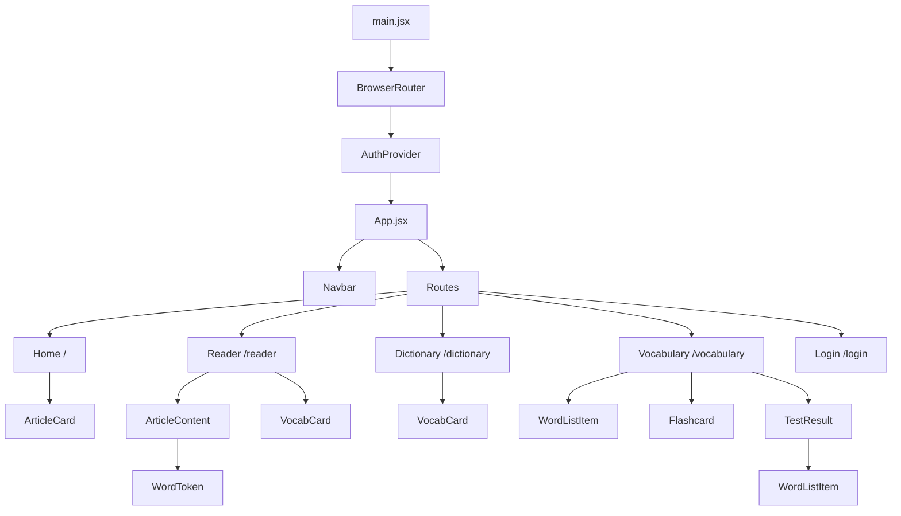
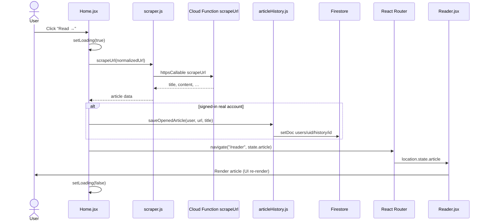
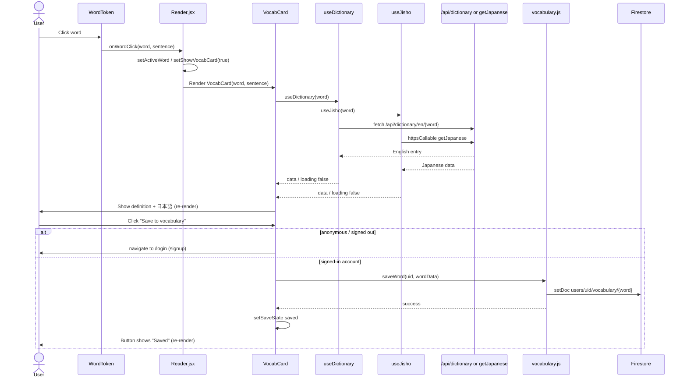
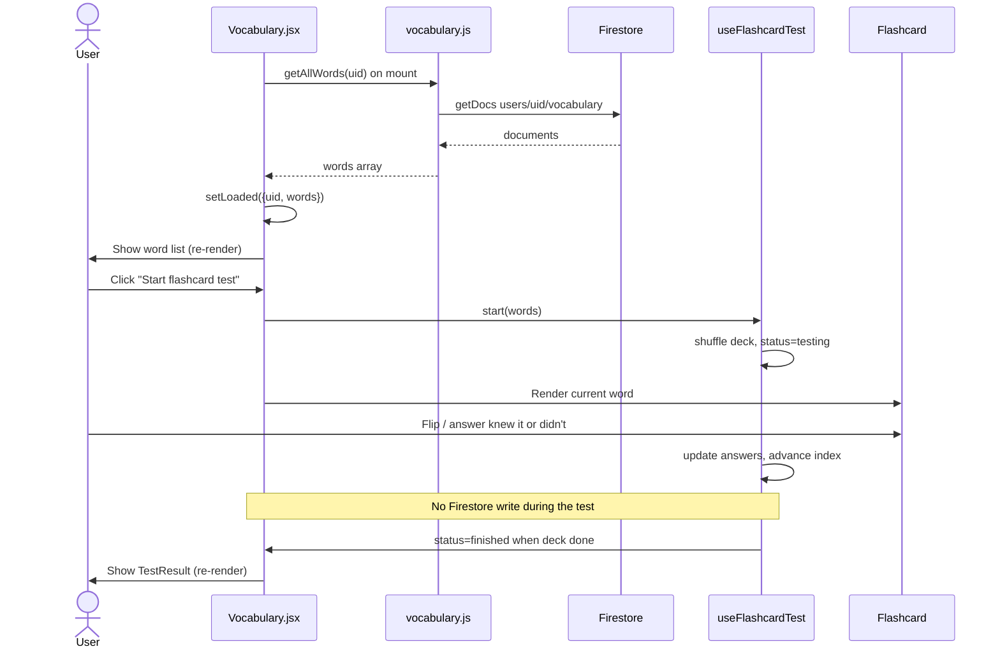

# Lexico — App Map

A beginner-friendly map of how this React + Firebase codebase fits together.
Every section lists the file path(s) it is based on. Anything guessed from
patterns (not written explicitly in the code) is marked **(inferred)**.

### Glossary (quick terms)

| Term | Plain-English meaning |
| --- | --- |
| **Component** | A reusable UI building block (a function that returns HTML-like JSX). |
| **Hook** | A React function starting with `use…` that holds or fetches state. |
| **Context** | A way to share data (like the current user) with many components without passing props down one by one. |
| **Props** | Values a parent component passes into a child component. |
| **State (`useState`)** | Data a component remembers that can change and cause a re-render. |
| **Re-render** | React redrawing the screen after state or props change. |
| **Route** | A URL path that shows a specific page component. |
| **Callable Cloud Function** | Server code the frontend calls by name (`httpsCallable`), not via a normal URL. |
| **HTTP Cloud Function** | Server code reached by a normal HTTP request (here: `/api/dictionary/...`). |
| **Firestore** | Firebase’s NoSQL database (collections of documents, like folders of JSON files). |
| **Document ID** | The unique name of one Firestore document inside a collection. |
| **Security Rules** | Server-side allow/deny rules that control who can read or write Firestore data. |
| **Anonymous auth** | A temporary Firebase login with no email; the app uses it so visitors can look words up without signing up. |
| **`onSnapshot`** | A live Firestore listener that pushes updates when data changes. |
| **Unsubscribe** | Stopping a listener so it no longer runs after the component leaves the screen. |
| **Emulator** | A local fake Firebase backend for development/testing. |

---

## 1. App overview

**Based on:** `CLAUDE.md`, `README.md`, `package.json`, `src/pages/*`, `functions/index.js`

Lexico helps Japanese learners of English: paste an article URL, read it in-app,
click any word for an English definition + Japanese translation, save words, and
review them with flashcards. There is also a standalone Dictionary page.

### Main libraries and their roles

| Library | Role |
| --- | --- |
| **React 19** (`react`, `react-dom`) — `package.json` | Builds the interactive UI from components. |
| **Vite 8** (`vite`, `@vitejs/plugin-react`) — `package.json`, `vite.config.js` | Dev server and production bundler for the frontend. |
| **React Router 7** (`react-router-dom`) — `src/main.jsx`, `src/App.jsx` | Maps URL paths to page components. |
| **Tailwind CSS v4** (`tailwindcss`, `@tailwindcss/vite`) — `package.json`, `src/index.css` | Utility CSS classes for styling (no `tailwind.config.js`). |
| **Firebase JS SDK** (`firebase`) — `src/services/firebase.js` | Client access to Auth, Firestore, and Cloud Functions. |
| **Firebase Cloud Functions** (`firebase-functions`, `functions/`) | Server-side scraping, Japanese lookup proxy, dictionary proxy. |
| **Mercury Parser** (`@postlight/mercury-parser`) — `functions/index.js` | Extracts readable article title/content from a URL on the server. |
| **Axios** (`axios`) — `functions/index.js` | HTTP client used by the `getJapanese` function to call Jisho. |

---

## 2. Folder structure

**Based on:** repository layout under `/workspace` (the app root).

```
english-reading-app/          (this repo root)
├── docs/                     App documentation (this file)
├── functions/                Cloud Functions backend (Node, CommonJS)
│   ├── index.js              Exports scrapeUrl, getJapanese, dictionary
│   ├── dictionary.js         English definition lookup + Wiktionary fallback
│   └── package.json          Functions-only dependencies
├── public/                   Static files copied as-is (favicon, icons)
├── src/                      Frontend React app
│   ├── main.jsx              App entry: mounts React + Router + AuthProvider
│   ├── App.jsx               Routes + global Navbar (hidden on /reader)
│   ├── index.css / App.css   Global styles (Tailwind import lives in index.css)
│   ├── assets/               Images/SVGs (mostly unused Vite/React placeholders)
│   ├── pages/                One file per screen (route-level components)
│   ├── components/           Reusable UI pieces used by pages
│   ├── context/              React Context (Auth)
│   ├── hooks/                Custom hooks (auth helper, dictionary, flashcards, …)
│   ├── services/             Firebase / API call wrappers
│   └── lib/                  Pure helpers (no React), e.g. article history utils
├── test/                     Node tests (article history helpers + Firestore rules)
├── firebase.json             Firebase Hosting / Functions / Auth / emulator config
├── firestore.rules           Who can read/write which Firestore paths
├── firestore.indexes.json    Composite indexes (currently empty)
├── .env.example              Template for Vite Firebase env vars
├── package.json              Frontend scripts and dependencies
└── vite.config.js            Vite plugins + local /api/dictionary middleware
```

### Notable files (one line each)

| Path | What it is |
| --- | --- |
| `src/services/firebase.js` | Creates the Firebase app; exports `auth`, `db`, `functions`. |
| `src/services/auth.js` | Email/password sign-up, login, logout + friendly error text. |
| `src/services/vocabulary.js` | Save / list vocabulary documents in Firestore. |
| `src/services/scraper.js` | Calls the `scrapeUrl` callable function. |
| `src/services/articleHistory.js` | Save + live-subscribe to opened-article history. |
| `src/services/claudeApi.js` | Empty placeholder (0 bytes); unused. |
| `src/hooks/useVocabulary.js` | Empty placeholder (0 bytes); unused. |
| `src/components/WordPopup.jsx` | Empty placeholder (0 bytes); unused. |
| `src/components/CounterCard.jsx` | Small stat card UI; **not imported anywhere** (inferred unused). |

---

## 3. Screens and routing

**Based on:** `src/main.jsx`, `src/App.jsx`, `src/pages/*`, `src/components/Navbar.jsx`

There are **no hard route guards** (no “must be logged in or redirect” wrapper).
Login is **soft**: anonymous visitors can browse and look up words; saving and
history need a real (email/password) account.

| URL path | Component | What the user can do | Requires login? |
| --- | --- | --- | --- |
| `/` | `Home` (`src/pages/Home.jsx`) | Paste a URL, scrape & open an article; see “Recently opened” history | **No** for reading. History list only for signed-in (non-anonymous) accounts. |
| `/reader` | `Reader` (`src/pages/Reader.jsx`) | Read scraped article; click words; open VocabCard | **No**. Article must be passed via navigation state from Home (refresh loses it). |
| `/dictionary` | `Dictionary` (`src/pages/Dictionary.jsx`) | Type a word, see definition/Japanese, optionally save | **No** to look up. **Yes** to save (redirects to `/login`). |
| `/vocabulary` | `Vocabulary` (`src/pages/Vocabulary.jsx`) | View saved words; run flashcard test | Soft gate: unsigned/anonymous users see a “Create an account” CTA instead of the list. |
| `/login` | `Login` (`src/pages/Login.jsx`) | Log in or sign up with email/password | N/A (if already signed in with a real account, redirects away). |

Navbar (`src/components/Navbar.jsx`) is shown on every screen **except** `/reader`
(Reader has its own header). Based on `src/App.jsx`.

---

## 4. Component hierarchy

**Based on:** `src/main.jsx`, `src/App.jsx`, `src/pages/*`, `src/components/*`

### Tree (per screen)

```
main.jsx
└── BrowserRouter
    └── AuthProvider
        └── App
            ├── Navbar                    (hidden when path === "/reader")
            └── Routes
                ├── /            → Home
                │   ├── HistoryStatus     (local helper inside Home.jsx)
                │   └── ArticleCard[]
                ├── /reader      → Reader
                │   ├── ArticleContent
                │   │   └── WordToken[]
                │   └── VocabCard         (when a word is clicked)
                ├── /vocabulary  → Vocabulary
                │   ├── WordListItem[]    (idle list)
                │   ├── Flashcard         (during test)
                │   └── TestResult        (after test)
                │       └── WordListItem[]
                ├── /dictionary  → Dictionary
                │   └── VocabCard
                └── /login       → Login
```

### Mermaid diagram



---

## 5. State management

**Based on:** `src/context/*`, `src/hooks/*`, `src/pages/*`, `src/components/VocabCard.jsx`

This app does **not** use Redux, Zustand, or similar. State is local React state,
one Auth Context, and a few custom hooks.

### Key pieces of data

| Data | Where it lives | Passed / used where |
| --- | --- | --- |
| Current Firebase `user` + `loading` | `AuthProvider` Context state (`src/context/AuthProvider.jsx`) | Read via `useAuth()` in `App`, `Navbar`, `Home`, `Vocabulary`, `Login`, `VocabCard` |
| Auth actions `signUp` / `logIn` / `logOut` | Same Context | `Login` (signUp/logIn), `Navbar` (logOut) |
| Home URL input + scrape loading/error | `useState` in `Home` | Local to Home form |
| Recently opened articles | `useArticleHistory` → `useState` + Firestore `onSnapshot` | Home renders `articles` / `status` |
| Scraped article being read | React Router `location.state.article` set by `navigate` from Home | `Reader` reads it; **not stored in Firestore** (only url/title go to history) |
| Active clicked word + sentence + VocabCard open | `useState` in `Reader` | Passed to `ArticleContent` / `VocabCard` |
| Dictionary search input + submitted word | `useState` in `Dictionary` | Submitted word → `VocabCard` |
| English definition for a word | `useDictionary` hook state | Used inside `VocabCard` |
| Japanese translation for a word | `useJisho` hook state | Used inside `VocabCard` |
| Save button status (`idle` / `saving` / `saved`) | `useState` in `VocabCard` | Local to that card |
| Saved vocabulary list | `useState` (`loaded`) in `Vocabulary` page, filled by `getAllWords` | Word list + flashcard `start(words)` |
| Flashcard test deck / index / answers | `useFlashcardTest` hook | `Vocabulary` + `Flashcard` / `TestResult` |
| Login form fields / mode / errors | `useState` in `Login` | Local to Login |

### Globally shared data

Only **auth** is truly global:

- `user`, `loading`, `signUp`, `logIn`, `logOut` via `AuthContext`
  (`src/context/AuthContext.js`, `src/context/AuthProvider.jsx`, `src/hooks/useAuth.js`)

Everything else is page-local or hook-local. The open article is shared only
through React Router navigation state (Home → Reader), not Context.

---

## 6. Firebase interactions

**Based on:** `src/services/*`, `src/context/AuthProvider.jsx`, `src/hooks/*`,
`functions/index.js`, `firebase.json`, `firestore.rules`

### Features used

| Feature | Used? | Where |
| --- | --- | --- |
| **Authentication** | Yes | Anonymous auto-sign-in + email/password (`AuthProvider`, `auth.js`) |
| **Firestore** | Yes | Vocabulary + article history under `users/{uid}/…` |
| **Cloud Functions** | Yes | `scrapeUrl`, `getJapanese` (callable); `dictionary` (HTTP) |
| **Hosting** | Yes (config) | Serves `dist/` and rewrites `/api/dictionary/**` + SPA fallback (`firebase.json`) |
| **Storage** | No | Not initialized or referenced |
| **Google Sign-In** | Declared in `firebase.json` only | **No client code uses it** (inferred unused for now) |

### Firestore data structure

```
users/{uid}/
  vocabulary/{wordId}     # wordId = lowercased English word
  history/{articleId}     # articleId = SHA-256 hex of normalized URL
```

#### `users/{uid}/vocabulary/{wordId}`

**Document ID:** `wordData.word.toLowerCase()` — `src/services/vocabulary.js`

| Field | Type | Notes |
| --- | --- | --- |
| `word` | string | Display form of the word |
| `definitionEn` | string | English definition (may be `""`) |
| `definitionJa` | string | Japanese form saved from Jisho kanji (may be `""`) |
| `exampleSentence` | string | From article sentence or dictionary example |
| `sourceArticleUrl` | string \| null | Optional; VocabCard accepts props but Reader currently does not pass them **(inferred always null from Reader)** |
| `sourceArticleTitle` | string \| null | Same as above |
| `savedAt` | Timestamp | Set with `serverTimestamp()` on every save write |
| `reviewCount` | number | Written as `0` on every save (including re-saves) |
| `lastReviewedAt` | null | Always written as `null` on save; flashcard test does **not** update Firestore |

#### `users/{uid}/history/{articleId}`

**Document ID:** SHA-256 of the normalized URL (`src/lib/articleHistory.js` → `articleHistoryId`)

| Field | Type | Notes |
| --- | --- | --- |
| `url` | string | Normalized http(s) URL |
| `title` | string | Article title (or hostname fallback), max 300 chars |
| `lastOpenedAt` | Timestamp | Must be server time (`serverTimestamp()`); rules reject client-forged times |

Article HTML/content is **not** stored in Firestore — only url + title + timestamp.
Content lives in memory via React Router state after scrape.

### Every Firestore read/write

| File | Function | Operation | Target collection |
| --- | --- | --- | --- |
| `src/services/vocabulary.js` | `saveWord` | `setDoc` (merge) | `users/{uid}/vocabulary/{wordId}` |
| `src/services/vocabulary.js` | `getAllWords` | `getDocs` | `users/{uid}/vocabulary` |
| `src/services/articleHistory.js` | `saveOpenedArticle` | `setDoc` (merge) | `users/{uid}/history/{articleId}` |
| `src/services/articleHistory.js` | `subscribeArticleHistory` | `onSnapshot` (query ordered by `lastOpenedAt` desc) | `users/{uid}/history` |

No app code uses `getDoc`, `addDoc`, `updateDoc`, or `deleteDoc`
(those appear only in `test/firestore.rules.test.js`).

### Cloud Function / HTTP calls (not Firestore, but Firebase-related)

| File | Function / call | Backend |
| --- | --- | --- |
| `src/services/scraper.js` | `httpsCallable(..., 'scrapeUrl')` | `functions/index.js` → Mercury Parser |
| `src/hooks/useJisho.js` | `httpsCallable(..., 'getJapanese')` | `functions/index.js` → Jisho API |
| `src/hooks/useDictionary.js` | `fetch('/api/dictionary/en/...')` | Prod: Hosting → `dictionary` HTTP function; Dev: Vite middleware in `vite.config.js` |

### Auth listeners

| File | API | Unsubscribed? |
| --- | --- | --- |
| `src/context/AuthProvider.jsx` | `onAuthStateChanged` | **Yes** — `return () => unsubscribe()` in `useEffect` cleanup |

### `onSnapshot` listeners

| File | Listener | Unsubscribed? |
| --- | --- | --- |
| `src/services/articleHistory.js` → used by `src/hooks/useArticleHistory.js` | `onSnapshot` on history query | **Yes** — hook cleanup sets `active = false` and calls `unsubscribe()` returned by `onSnapshot` |

---

## 7. Key user flows

### Flow A — Paste URL → read article

**Based on:** `src/pages/Home.jsx`, `src/services/scraper.js`, `src/services/articleHistory.js`, `src/pages/Reader.jsx`



### Flow B — Click a word → look up → save

**Based on:** `src/pages/Reader.jsx`, `src/components/ArticleContent.jsx`, `src/components/WordToken.jsx`, `src/components/VocabCard.jsx`, `src/hooks/useDictionary.js`, `src/hooks/useJisho.js`, `src/services/vocabulary.js`



### Flow C — Start flashcard test

**Based on:** `src/pages/Vocabulary.jsx`, `src/hooks/useFlashcardTest.js`, `src/services/vocabulary.js`, `src/components/Flashcard.jsx`



---

## 8. Concerns

### Security Rules — what they allow

**Based on:** `firestore.rules`, `test/firestore.rules.test.js`

Rules are **owner-only** for signed-in, **non-anonymous** users:

- `users/{uid}/vocabulary/{wordId}` — read/write only if `request.auth.uid == uid` **and** sign-in provider is not `anonymous`.
- `users/{uid}/history/{articleId}` — read for owner; create/update only with a strict shape (url/title/lastOpenedAt), SHA-256-looking id, and `lastOpenedAt == request.time`. URL cannot change on update. **No delete** allowed by rules.

Anything else under Firestore is denied by default (no matching `allow`).

**Not “anyone can read/write”** — the old open test-mode rules appear to have been replaced.

**Residual concerns:**

| Concern | Detail |
| --- | --- |
| Anonymous users | Correctly blocked from Firestore vocab/history; lookups go through Functions/HTTP instead. |
| Dictionary HTTP function | `invoker: 'public'` — anyone can call `/api/dictionary/...` **(intentional for lookups; inferred abuse risk = rate limiting only)**. |
| Callable functions | `scrapeUrl` / `getJapanese` do not check auth in `functions/index.js` **(inferred: any client that can reach Functions can call them)**. |
| Client config | Firebase web API keys in `.env` are expected to be public; **security depends on Rules + Function logic**, not hiding the key. |

### Logic duplicated in multiple places

| Pattern | Where it appears |
| --- | --- |
| “Signed in” means `user && !user.isAnonymous` | `Navbar.jsx`, `Vocabulary.jsx`, `VocabCard.jsx` (similar idea also in `lib/articleHistory.js` → `historyViewer`) |
| Cancelled-flag + word-tagged async result | `useDictionary.js` and `useJisho.js` are nearly the same shape |
| Soft “go create an account to save” UX | `VocabCard` (save click) and `Vocabulary` (empty gated page) |
| Brand header mark (green circle + “Lexico”) | `Navbar.jsx` and again custom header in `Reader.jsx` |

### Top 5 files to read first (as a beginner)

| # | File | Why start here |
| --- | --- | --- |
| 1 | `src/main.jsx` | Tiny entry point: shows how Router + Auth wrap the whole app. |
| 2 | `src/App.jsx` | The route table — your map of every screen. |
| 3 | `src/context/AuthProvider.jsx` | Explains anonymous vs real accounts (everything “can I save?” depends on this). |
| 4 | `src/pages/Home.jsx` | The main product loop start: scrape → optional history save → navigate to Reader. |
| 5 | `src/components/VocabCard.jsx` | Where dictionary + Japanese hooks meet the Save button and Firestore. |

**After those five,** read `src/services/vocabulary.js` and `firestore.rules` to see how saved words are stored and protected.

### Other beginner pitfalls worth knowing

- **Refreshing `/reader` loses the article** — content is only in `location.state`, not reloaded from the network or Firestore.
- **Re-saving a word resets `reviewCount` / `lastReviewedAt` / `savedAt`** — `setDoc(..., { merge: true })` still overwrites those fields because `saveWord` always sends them (`src/services/vocabulary.js`).
- **Flashcard answers are not written back to Firestore** — review stats exist on the document schema but the test hook never updates them **(inferred unfinished feature)**.
- **Empty placeholder files** (`claudeApi.js`, `useVocabulary.js`, `WordPopup.jsx`) can look important but currently do nothing.
- **Dev vs prod Firebase:** by default `npm run dev` still uses production Auth/Firestore unless `VITE_USE_FIREBASE_EMULATORS=true`; only Functions are auto-pointed at the emulator in DEV (`src/services/firebase.js`).
